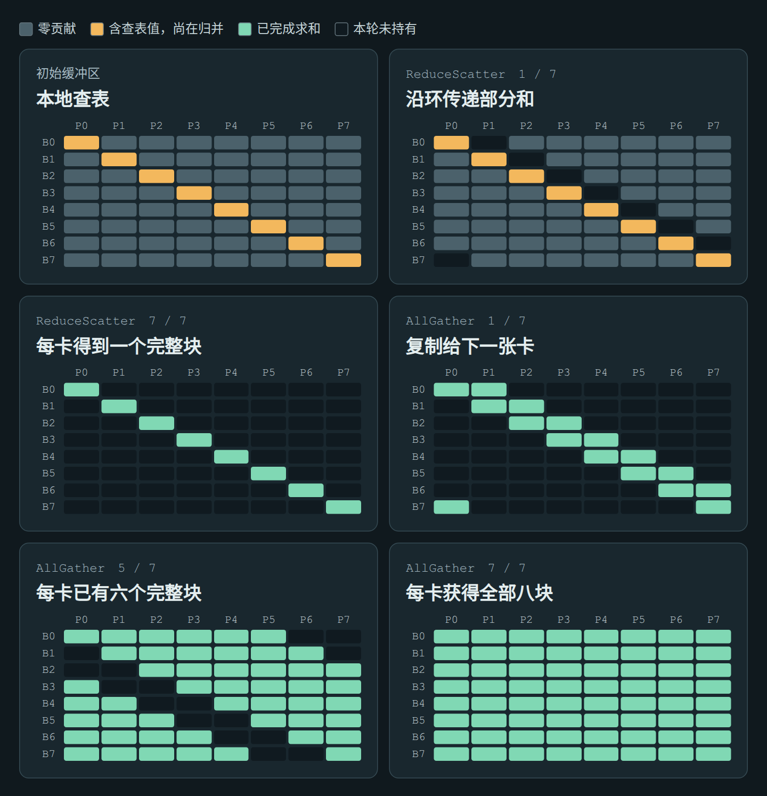

  

<h1 align="center">逐卡看懂一次大模型推理</h1>

  Follow one request across GPUs, from prompt to response. 
  <strong><a href="https://haoyangping0324.github.io/where-tensors-go/">打开交互演示 ↗</a></strong>

一条请求从输入框走到第一个输出 token，经过了哪些 GPU？**where-tensors-go** 把模型计算画在卡上。沿着一次请求前进，可以看到每张卡持有哪些权重、算出了哪一段张量，以及下一步要把它发给谁。

## 从一个词向量看懂八卡通信

在演示中打开 **Prefill → Embedding → 合并查表结果**。八张卡各持一段词表，同时收到这条提示的 16 个 token ID。对于一个 ID，命中的卡取出 6,144 维词向量，另外七张卡在对应位置填零。逐元素相加就能还原完整的词向量。难点在于，让八张卡都拿到结果。

下图截取环形 AllReduce 的六个时刻。**每列是一张卡，每行是一个张量分块。** 例如 B0 包含提示中第 0 和第 8 个位置，形状为 `[2, 6144]`。沿着 B0 横向读，就能看到它从局部贡献变成八张卡都持有的完整块。

**ReduceScatter** 的七轮结束后，P0 持有求和完毕的 B0，P1 持有 B1，依此类推。接下来 **AllGather** 复制这些结果。第一轮 P0 把 B0 发给 P1，第五轮已有六张卡持有 B0，最后每张卡都拼齐形状为 `[16, 6144]` 的输入矩阵。在交互图中点击任意传输箭头，可以查看这一跳的源卡、目的卡和载荷形状。

## 继续沿请求前进

| 在目录中打开 | 在 GPU 上观察 |
| --- | --- |
| **Prefill → Attention** | Q 和 KV 怎样从隐藏状态投影出来，候选位置怎样参与注意力计算。切换并行方案，对照每卡持有的头数和位置数。 |
| **Prefill → FFN · MoE** | 一个 token 命中哪些专家，专家的 Gate、Up、Down 投影怎样产生可合并的输出。 |
| **PD 交接 → KV 缓存传输** | 提示处理完毕后，请求的缓存从 Prefill 节点交给 Decode 节点。 |
| **Decode → Attention** | 只有一个新位置需要计算查询，它怎样读取历史 KV，并一步步产生下一个 token。 |

演示使用模型配置中的维度。token、专家命中和环形通信轮次采用教学示例。下载仓库后，直接用浏览器打开 `index.html` 也可离线浏览。

[模型配置](https://huggingface.co/zai-org/GLM-5.3/blob/main/config.json) · [PD 分离配方参考](https://github.com/ai-dynamo/dynamo/blob/v1.6.1/recipes/glm-5.2/sglang/disagg-h200-agentic/deploy.yaml) · [通信可视化参考 · InferFlux](https://abatom.github.io/inferflux/collective-3d.html)
