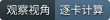
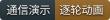
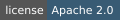
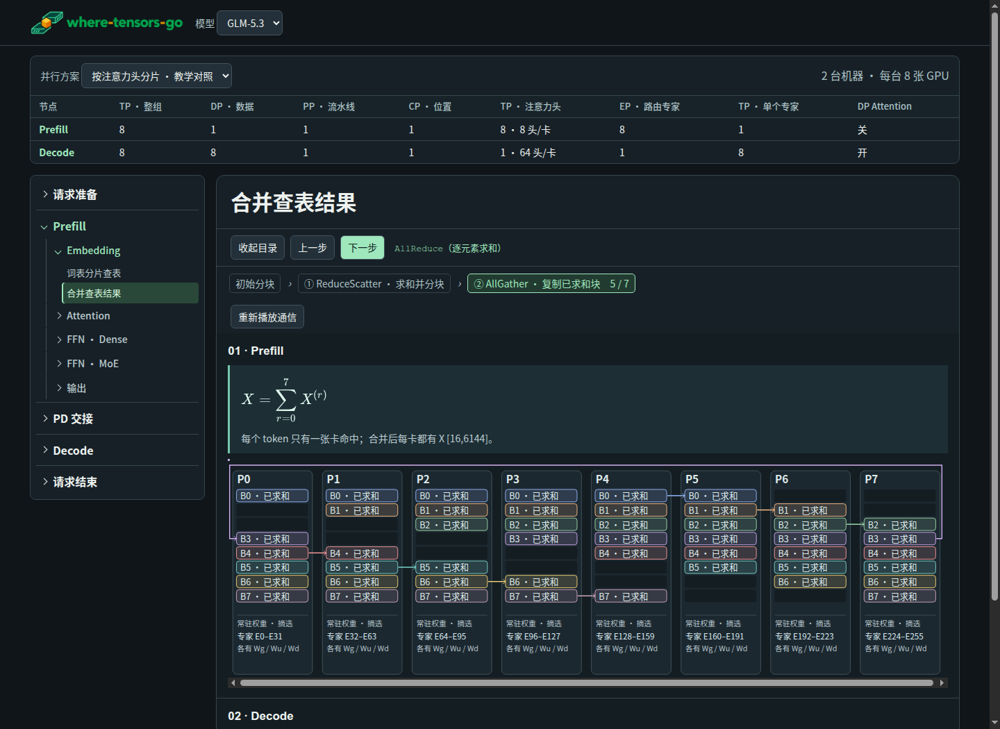

  

<h1 align="center">看见张量在 GPU 之间流动</h1>

  <strong>大模型分布式推理的交互式图解</strong> 
  跟随一次请求，从输入到回复，看清每张 GPU 上的计算、权重与通信。

  
  &nbsp;
  &nbsp;
  &nbsp;

## ✨ 项目特色

**🧭 一条完整的请求路径** 
从聊天请求接入、分词和调度，到 Prefill、跨节点状态交接、Decode 和流式返回，服务端事件与 GPU 计算出现在同一份分层目录里。既能顺着请求看全程，也能直接进入关心的模型层和算子。

**▦ 把算子展开到每张 GPU** 
每张卡在图上都有固定位置。输入张量、常驻权重和输出画在对应卡内，配上矩阵形状、分片范围与计算公式。看一次投影，就能对上本卡读了哪段输入、乘了哪部分权重、留下了什么结果。

**⇄ 看得见的跨卡通信** 
连线标出发送卡与接收卡，点开即可查看传输的张量和维度。集合通信按轮播放，把各卡缓冲区放在一张图里，同时呈现分块怎样传送、累加和复制。

**🧩 保留模型各层的差异** 
演示按模型的实际层结构组织计算。注意力可以展开到查询投影、索引与缓存读写；前馈层可以区分 Dense 与 MoE，继续观察专家路由、专家计算和结果合并。混合架构还可以逐卡查看递归状态、卷积历史和注意力 KV 在两个节点之间的交接。

**⚙️ 对照并行配置与数据布局** 
并行参数和逐卡视图联动。以注意力为例，切换按头分片和按位置分片，同一个算子在每张卡上负责的头数、token 位置和矩阵形状会随之变化。GPU 数量及并行度由具体演示场景给出。
