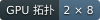
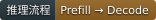

  

<h1 align="center">看见张量在 GPU 之间流动</h1>

  一个交互式大模型推理可视化项目。跟随一次请求，从输入到回复， 
  看每张 GPU 存了什么、算了什么，又把结果交给了谁。

  
  &nbsp;
  &nbsp;

## 🧭 怎样读这张图

- **沿请求走** · 从目录选择一个阶段，或点「下一步」，跟随同一个请求经过 Prefill、KV 交接和 Decode。
- **往卡里看** · 每张卡的位置固定。点击卡内的数据块，查看本步的张量形状、权重分片和计算结果。
- **顺着线看** · 通信动画逐轮更新各卡的缓冲区。点击连线，就能看到这一跳的发送卡、接收卡和传输内容。
